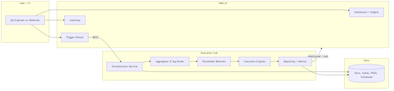
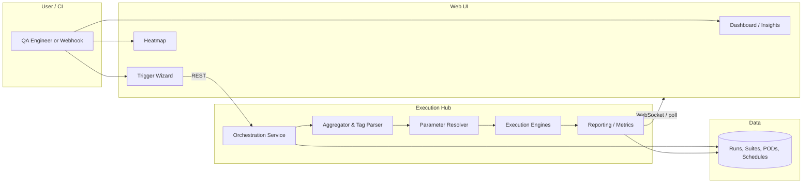
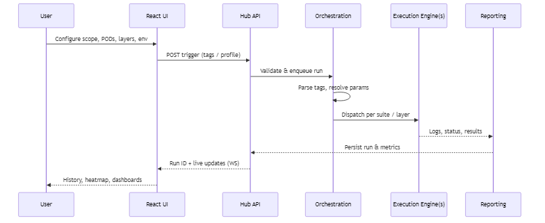
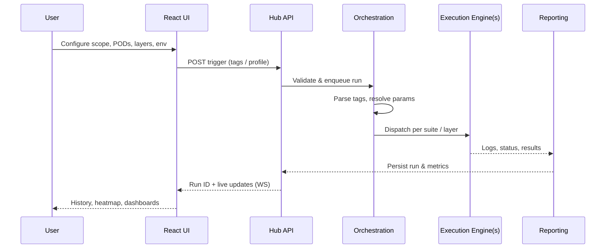
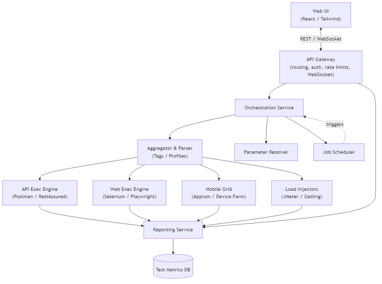
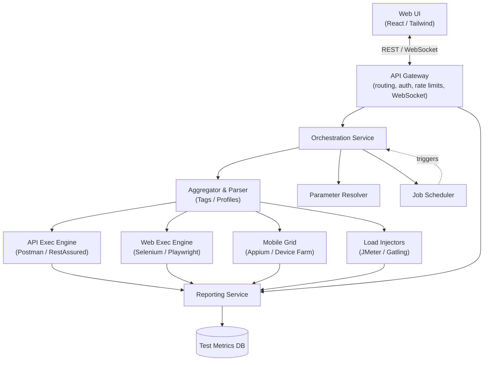

# Automation Execution Hub — Confluence Pack

**Purpose:** Paste sections into Atlassian Confluence (or export this file).

**Why diagrams looked blank:** Atlassian Confluence’s default page editor **does not render** fenced ` ```mermaid ` code blocks. Use one of these:

| Option | What to do |
|--------|------------|
| **A. Insert the PNGs (recommended)** | Attach **`docs/confluence-diagrams/*.png`** to the Confluence page and place each image under §1–§3 below. |
| **B. Use the ASCII diagrams** | Copy the **Text diagram (Confluence-safe)** blocks—they display as plain text when pasted. |
| **C. Mermaid in Confluence** | Install a marketplace app such as *Mermaid Diagrams for Confluence*, then paste the Mermaid source from **`docs/confluence-diagrams/*.mmd`**. |
| **D. GitHub / GitLab** | Mermaid + embedded PNGs below render in the repo browser. |

Source files: `docs/confluence-diagrams/` — `01-plan-flow`, `02-request-sequence`, `03-architecture-hld` (`.mmd` + `.png`).

**Related:** Technologies & libraries → `CONFLUENCE_TECH_STACK.md` · Action items → `CONFLUENCE_ACTION_ITEMS.md`.

---

## This is our plan

We are building a **centralized Automation Execution Hub**: one place to **manage, schedule, and run** automation across **PODs** (domains) and **test types** (API, Web, Mobile, Performance). The hub **orchestrates** between users and real execution infrastructure (CI, grids, load injectors), supporting **Smoke**, **Sanity**, and **Regression** with **tag-driven** and **profile-based** triggers.

**Delivery approach:** ship an integrated **Web UI + Orchestration API** first (current repo), then harden **scheduling**, **real engines**, **security**, and **advanced UX** (dependency matrix, production-grade gateway) as phased work.

---

## 1. Plan flow (high level)

End-to-end flow from intent to result.

**Image (for Confluence):** use `docs/confluence-diagrams/01-plan-flow.png`.



**Text diagram (Confluence-safe):**

```
  User / CI ──► Web UI (Dashboard, Trigger Wizard, Heatmap)
                      │
                      │  REST (trigger)
                      ▼
               Orchestration ──► Aggregator ──► Parameter Resolver
                      │                │
                      │                └──► Execution Engines ──► Reporting / metrics
                      │                                              │
                      └──────────────────► Data store ◄─────────────┘
                                                (runs, suites, PODs, schedules)

  Reporting ── WebSocket or poll ──► Web UI (live status)
```

**Mermaid source** (for GitHub, GitLab, or a Confluence Mermaid app — see `docs/confluence-diagrams/01-plan-flow.mmd`):



---

## 2. Request → run sequence (logical)

**Image (for Confluence):** use `docs/confluence-diagrams/02-request-sequence.png`.



**Text diagram (Confluence-safe):**

```
  User          React UI       Hub API       Orchestration    Engine(s)     Reporting
    │               │              │               │               │              │
    │── configure ─►│              │               │               │              │
    │               │── POST ─────►│               │               │              │
    │               │   trigger    │── validate ──►│               │              │
    │               │              │               │── dispatch ──►│              │
    │               │              │               │               │── logs ─────►│
    │               │◄─ run id ────│◄── persist ───│◄──────────────│◄─────────────│
    │               │   + WS       │               │               │              │
    │◄── results ───│              │               │               │              │
```

**Mermaid source** (`docs/confluence-diagrams/02-request-sequence.mmd`):



---

## 3. Architecture diagram (HLD)

*Logical view; implementation may collapse gateway and API into one Spring Boot app until a dedicated gateway is introduced.*

**Image (for Confluence):** use `docs/confluence-diagrams/03-architecture-hld.png`.



**Text diagram (Confluence-safe):**

```
                        ┌─────────────────┐
                        │ Web UI (React)  │
                        └────────┬────────┘
                                 │ REST / WebSocket
                                 ▼
                        ┌─────────────────┐
                        │  API Gateway    │
                        └────────┬────────┘
                    ┌────────────┴────────────┐
                    ▼                         ▼
           Orchestration Service      Reporting Service
                    │                         ▲
        ┌───────────┼───────────┐             │
        ▼           ▼           ▼             │
   Aggregator   Param resolver  Job Scheduler │
        │           │           │             │
        └─────┬─────┴─────┬─────┘             │
              │           │                   │
    ┌─────────┴───┐   ┌───┴─────────┐         │
    ▼             ▼   ▼             ▼         │
 API engine   Web engine  Mobile    Load      │
              engines     grid      injectors │
              └────────────┬────────────┘     │
                           └───────────────────┘
                                        │
                                        ▼
                                 Test metrics DB
```

**Mermaid source** (`docs/confluence-diagrams/03-architecture-hld.mmd`):



---

# High-Level Design (HLD): Automation Execution Hub

## 1. System Overview

The Automation Execution Hub is a centralized platform designed to manage, execute, and schedule automation test suites across multiple domains (PODs) and testing types (API, Web, Mobile, Performance). It acts as an orchestration layer between the user and underlying test execution infrastructures, enabling intelligent, targeted test runs like Smoke, Sanity, and full Regression across various architectural layers.

## 2. Architecture Diagram (text reference)

```
[ Web UI (React/Tailwind) ]  <-- (REST / WebSockets) -->  [ API Gateway ]
                                                                |
                                        +-----------------------+-----------------------+
                                        |                                               |
                             [ Orchestration Service ]                           [ Reporting Service ]
                                |                |                                      |
                     [ Job Scheduler ]    [ Aggregator & Parser]                 [ Test Metrics DB ]
                            |             (Handles Tags/Profiles)                       |
            +---------------+--------------------+---------------+                      |
            |               |                    |               |                      |
    [ API Exec Engine ] [ Web Exec Engine ] [ Mobile Grid ] [ Load Injectors ]  --------+
      (Postman/RestAssured) (Selenium/Playwright) (Appium/DeviceFarm) (JMeter/Gatling)
```

## 3. Core Components

### 3.1. Frontend (Web UI)

- **Framework:** React.js with Tailwind CSS (Sky Blue Tech Theme).
- **Responsibilities:**
  - Provide an intuitive dashboard for execution overview and historical trends.
  - Enable multi-dimensional filtering (by POD, Test Level, Tag, Platform).
  - Feature an interactive Trigger Wizard for complex cross-POD execution.
  - Manage execution profiles (e.g., Nightly Regression, Hotfix Smoke).

### 3.2. API Gateway

**Responsibilities:** Request routing, authentication/authorization, rate limiting, and handling WebSocket connections for real-time execution status updates.

### 3.3. Orchestration Service

- **Responsibilities:**
  - Receives execution requests (Ad-hoc, Scheduled, or Tag-based).
  - **Aggregator & Parser:** Resolves complex triggers (e.g., "Run all @smoke tests for Mobile & API in Onboarding POD").
  - **Parameter Resolver:** Fetches environment variables, secrets, and POD-specific configurations before injecting them into the test suite.
  - Routes the parsed payloads to the specific execution engine (API, Web, Mobile, Performance) simultaneously to maximize parallelization.

### 3.4. Job Scheduler

**Responsibilities:** Handles recurring automation tasks. Uses a distributed task queue (e.g., Celery, RabbitMQ, or AWS EventBridge) to trigger the Orchestration Service based on defined CRON schedules or CI/CD webhooks.

### 3.5. Execution Engines

Decoupled worker nodes capable of running specific frameworks. They receive the code, parameters, and environment context, execute the suite, and stream logs/results back to the Reporting Service.

## 4. Data Model (High Level)

| Entity | Fields (summary) |
|--------|-------------------|
| **Test_Suite** | id, name, description, pod_id, type (API/Web/Mobile/Perf), repository_url, tags (e.g., `['smoke', 'p0', 'regression']`) |
| **POD** | id, name (e.g., Onboarding, Disbursement), owner, env_vars |
| **Execution_Profile** | id, name (e.g., "Pre-Release Smoke"), target_tags, target_pods, target_types |
| **Execution_Run** | id, profile_id (optional), status (Running, Passed, Failed), triggered_by, start_time, end_time, parameters_used |
| **Schedule** | id, suite_or_profile_id, cron_expression, is_active, parameters |

## 5. Security & Access

- **Role-Based Access Control (RBAC):** Developers can trigger runs in `Dev`, but only QA Leads/Release Managers can trigger runs in `Staging/Production`.
- **Secrets management** integrated via HashiCorp Vault or AWS Secrets Manager to prevent hardcoded credentials in parameters.

## 6. Advanced Dashboard & Execution Features (Ideation)

### 6.1. The "Unified Trigger Wizard"

Instead of triggering suites one by one, a modal wizard allows users to slice and dice what they want to run on the fly:

1. **Scope Selection** — Choose Smoke, Sanity, Regression, or Full Execute.
2. **POD Targeting** — Multi-select domains (e.g., Onboarding AND Payments).
3. **Layer Targeting** — Select platforms (API, Web/UI, Mobile Android, Mobile iOS).
4. **Environment & Deploy** — Choose Dev/Staging/Prod and inject dynamic datasets.

### 6.2. Execution Profiles (Saved Configurations)

QA Leads can save frequently used Trigger Wizard configurations as **Profiles**.

**Example:** A card on the dashboard titled "Hotfix Sanity Check". Clicking "Run" on this card instantly triggers a predefined blend: Onboarding API Smoke tests + Disbursement Web Sanity tests + Payment Mobile UI tests.

### 6.3. Tag-Based Orchestration

At the core of the engine, tests are driven by tags. The UI provides a powerful search/trigger bar where users can input boolean logic:

- Run: `@regression AND (@pod:disbursement OR @pod:payments) AND NOT @flaky`

This empowers engineers to run highly specific subsets of tests without maintaining rigid, hardcoded suites.

### 6.4. Cross-POD Dependency Matrix

A visual node-graph representation showing how PODs interact. If a user tries to run a Regression on the Disbursement POD, the system prompts: *"Disbursement relies on Onboarding APIs. Would you like to run Onboarding API Smoke tests first?"*

### 6.5. Execution Topology Heatmap

A visual grid on the dashboard for quick 1-click execution and status monitoring:

- **Y-Axis:** PODs (Onboarding, Disbursement, Payments).
- **X-Axis:** Test Types (API, UI, Mobile).
- **Cells:** Each cell represents the aggregation of tests for that intersection. Clicking a cell (e.g., Onboarding × API) opens a quick-menu to run Smoke or Regression specifically for that node. The cells change color (Green/Red) based on the latest nightly runs.

**Action items & status tracker:** see `CONFLUENCE_ACTION_ITEMS.md` (kept separate from this design doc).

---

## Confluence paste tips

1. Copy **Mermaid** into a page that supports the *Mermaid* macro, or export SVG from [mermaid.live](https://mermaid.live).
2. Use **Info** panel for the "This is our plan" paragraph.
3. Pin this page under **QA** or **Engineering** space with labels: `automation`, `hld`, `execution-hub`, `roadmap`.

---

*Last updated: aligned with QA_Dashboard repository layout and README.*
